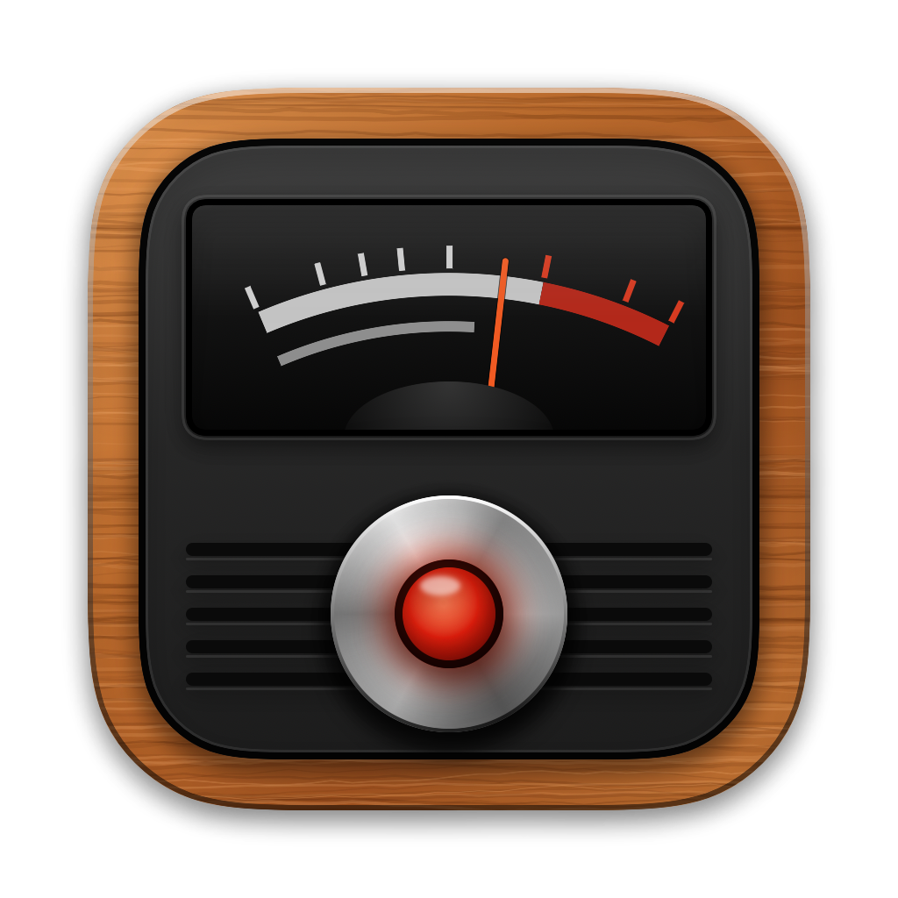

<p align="center"></p>

# Earshot

A small retro recorder for macOS that records the audio your apps are playing (a browser tab,
a podcast app, a video player) to `.m4a` files. It never uses the microphone, and you keep
hearing everything normally while it records.

Handy for saving shows and streams to study later, for example for language practice.

## Features

- **Record one app or all apps.** Pick a running app from the Source menu (apps currently
  playing sound are listed first) or choose All Apps. Browser tabs work: Earshot taps the app's
  helper processes too, including ones that start playing after you press Record.
- **Named files.** The name field sets the file name. Files are saved to
  `~/Music/Earshot`, and an existing file is never overwritten (`Name 2.m4a`, `Name 3.m4a`, …).
- **Analog VU meter**, a running counter, and a menu bar icon that shows the elapsed time.
- **Real-time files.** If the app goes quiet or its audio process restarts, the gap is kept as
  silence, so timestamps in the file match the original.
- AAC at 128 kbps stereo, about 1 MB per minute.

| Shortcut | Action |
| --- | --- |
| ⌘R | Start / stop recording |
| ⌘W | Hide the panel (click the Dock icon to bring it back) |

## Requirements

- macOS 26 or later (uses `CATapDescription.bundleIDs`, new in macOS 26)
- Swift 6.2 toolchain (Xcode 26 or the matching Command Line Tools)

## Build and install

```bash
./build_app.sh --install
```

This builds a release `.app`, signs it with your first *Apple Development* certificate (set
`SIGN_IDENTITY` to choose another), and replaces `/Applications/Earshot.app`. Without
`--install` it only builds `.build/Earshot.app`.

A stable signing identity matters: macOS ties the audio-recording permission to the app's
signature, so ad-hoc builds lose the permission every time you rebuild.

## Permissions

Earshot needs **System Audio Recording Only** (System Settings → Privacy & Security → Screen &
System Audio Recording). It asks on first launch; the gear button shows the current state and
links to the setting.

macOS doesn't reliably show this prompt on its own when a tap starts, so Earshot requests it
through the private `TCCAccessRequest` call in TCC.framework (see
`AudioCapturePermission.swift`). That is fine for a personally built app but would not pass
App Store review, and a future macOS release could change it.

## How it works

1. `CATapDescription` describes what to capture: a global stereo tap for All Apps, or the app's
   bundle ID plus its helper bundle IDs with process restore enabled.
2. The tap goes into a private aggregate device, and an IO callback copies each buffer to a
   serial queue that encodes it to AAC with `AVAudioFile`.
3. When a process joins or leaves an app tap, Core Audio can stop calling the IO callback. A
   watchdog notices the stall, rebuilds the aggregate device around the same tap, and pads the
   gap with silence based on host time.

## Project layout

```
Sources/Earshot/
  EarshotApp.swift            App entry, menus, menu bar item, the panel's borderless window
  AppModel.swift              Recording flow, file naming, alerts
  SystemAudioRecorder.swift   Core Audio tap → aggregate device → AAC file, watchdog, silence padding
  AppSources.swift            Running apps and the bundle IDs to tap for each
  AudioCapturePermission.swift
  CoreAudioSupport.swift      Small Core Audio property helpers
  RecorderPanel.swift         Panel layout, wood frame, drag handles
  VUMeter.swift
  PanelControls.swift         Source menu, record button, name field, counter, settings, grille
  RetroStyle.swift, MenuBarGlyph.swift
tools/make_icon.swift         Renders Resources/AppIcon.icns (run: swift tools/make_icon.swift)
build_app.sh                  Builds, signs and optionally installs the .app
```
